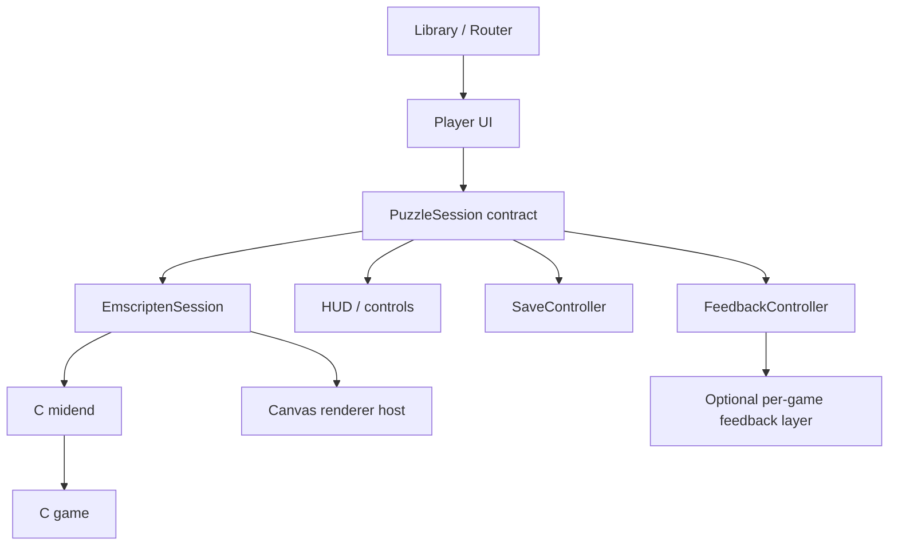

# Puzzle Studio — Kế hoạch triển khai web để bàn giao cho coding model

Ngày lập: 2026-10-08.
Trạng thái: kế hoạch thực thi; chưa có frontend game mới hoặc CI deploy được triển khai.
Hướng giao diện đã chọn: **Calm Studio**.
Repo làm việc tại thời điểm lập kế hoạch: `D:\DMHoang\puzzles`, nhánh hiện tại `master`. Khi bắt đầu, kiểm tra lại trạng thái thực tế.

## 0. Prompt bàn giao

Có thể giao nguyên phần sau cho model triển khai:

> Đọc `AGENTS.md` nếu có, `docs/web-implementation-plan.md` và `docs/web-modernization-design.md`. Triển khai Puzzle Studio trong repo hiện tại theo kế hoạch, với Calm Studio, EN/VI, game feel và khả năng build/deploy GitHub Pages. Giữ engine C và generator/solver của Simon; mọi game trong thư viện phải dùng engine thật. Làm Net trước để kiểm chứng WASM và session lifecycle, tiếp theo Solo/Light Up, sau đó toàn bộ game ổn định trong repo. Hoàn thành từng milestone và kiểm tra tiêu chí nghiệm thu trước khi mở rộng. Được tự quyết các chi tiết thường lệ; ghi lại quyết định kỹ thuật, toolchain đã dùng, lệnh tái hiện và vấn đề còn tồn tại. Không dừng ở mockup hoặc frontend dùng dữ liệu giả. Không coi ba game pilot là hoàn thành toàn bộ yêu cầu. Nếu môi trường thiếu compiler/browser/credential, hoàn thành phần không phụ thuộc, ghi rõ phần nào chưa kiểm chứng và hướng dẫn chạy tiếp. Tạo workflow deploy và hướng dẫn bật Pages; chỉ tuyên bố đã publish khi URL thật được xác minh. Không thay đổi source native/iOS ngoài những thay đổi dùng chung thực sự cần thiết. Không push, merge hoặc publish chỉ vì các thao tác đó xuất hiện trong kế hoạch; tuân theo phạm vi ủy quyền của phiên triển khai.

File này là nguồn quyết định triển khai. File `web-modernization-design.md` giải thích ý tưởng sản phẩm; nếu khác nhau, ưu tiên contract và tiêu chí cụ thể trong file này.

## 1. Mục tiêu và ranh giới

### Bắt buộc cho release v1

- Thư viện game và màn hình chơi mới, responsive, theo Calm Studio.
- Chơi bằng engine C thật được build thành WebAssembly; không rewrite logic bằng JavaScript.
- Hỗ trợ toàn bộ game ổn định được liệt kê ở mục 3, gồm presets/configuration và điều khiển cần thiết cho từng game.
- EN/VI cho app, luật chơi và các engine strings reachable trong release.
- Chuột, bàn phím và touch; thao tác phụ có cách dùng rõ trên mobile.
- Undo/Redo/New/Restart; Solve chỉ hiện với game hỗ trợ. Không gọi Solve là Hint.
- Lưu/khôi phục ván, favorite, settings; chia sẻ đề bằng Game ID.
- Light/Dark, Reduced motion, âm thanh opt-in, shared feedback cho toàn collection.
- Polish riêng thực sự cho Net và Light Up; giữ và tích hợp animation có sẵn của các game khác.
- Build production chạy được dưới repo subpath; GitHub Actions build/check/deploy; hướng dẫn GitHub Pages.
- Giữ `LICENCE`, ghi công Simon và các tác giả; không trình bày như sản phẩm chính thức của Simon.

### Ngoài phạm vi v1

- Tài khoản, backend, multiplayer, leaderboard, mua hàng, quảng cáo.
- Daily puzzle, streak, achievement, hệ thống Hint mới cho mọi game.
- Import toàn bộ upstream mới hoặc thêm game không có trong repo.
- PWA/service worker/offline cold-start. Save local không đồng nghĩa với offline support.
- Renderer WebGL/Pixi/Unity WebGL, đổi engine hoặc rewrite toàn collection.
- Screen reader đọc và chơi được mọi ô của mọi game: cần adapter riêng, không tuyên bố đã có.
- Per-game juice sâu cho toàn bộ collection trong một lượt. Theo dõi phần bổ sung này riêng, không chặn release v1 khi shared feedback và các pilot đã đạt.

Không bỏ âm thầm game khó migrate. Nếu có blocker, đánh dấu rõ trong coverage report; release toàn collection chưa đạt cho đến khi xử lý hoặc có quyết định giảm scope từ người dùng.

## 2. Hiện trạng đã xác minh

| File/khu vực | Vai trò và lưu ý |
| --- | --- |
| `README` | Hướng dẫn generate Makefile bằng `mkfiles.pl` |
| `Recipe`, `*.R` | Nguồn mô tả game/dependency, dùng làm nguồn build chính |
| `mkfiles.pl` | Có generator `Makefile.emcc`, dùng `ASM_JS=1`, thay GTK object bằng Emscripten frontend |
| `emcc.c` | Bridge C, input, commands, canvas, palette, config, presets; `me` và các resource đang là global trong module |
| `emccpre.js` | Globals JS, `Module`, init theo DOM ID, mouse/keyboard, `setCapture` cũ |
| `emcclib.js` | Drawing/dialog/status callbacks; `Pointer_stringify`; style DOM hardcode; timer 20 ms |
| `emccx.json` | Exports cũ; có comment nên không phải JSON strict |
| `html/jspage.pl` | Generator trang web cũ, ASCII, controls/DOM ID cố định |
| `puzzles.h`, `midend.c` | API game orchestration, lịch sử, serialisation, redraw/timer/status |
| `net.c` | Đã có rotation animation, completion flash và `used_solve` |
| `lightup.c`, `solo.c` | Có completion flash và cờ assisted ở state; Light Up chưa có move animation trong hook hiện tại |
| `index.html`, các HTML ở root | Tài liệu; không phải app launcher mới |
| `.gitignore` | Bỏ qua Makefile generated và root HTML; phải chọn nơi output có chủ ý |

Các API dùng chung hiện có: `midend_new/free`, `midend_process_key`, `midend_status`, `midend_can_undo/redo`, `midend_num_presets/fetch_preset`, `midend_get_config/set_config`, `midend_game_id`, `midend_get_game_id/get_random_seed`, `midend_serialise/deserialise`, `midend_force_redraw`, `midend_stop_anim`, `midend_timer`.

Quan trọng: `midend_process_key()` trả giá trị phục vụ tiếp tục/thoát, **không phải accepted-move boolean**. `interpret_move` có thể chỉ đổi UI, cần redraw nhưng không tạo game state mới. Không dùng return value, trạng thái enabled của Undo hoặc chuỗi statusbar để đoán mọi nước đi.

Website Simon hiện có JS/WASM; local repo là snapshot cũ khác upstream. Artifact từ website không phải artifact build của repo này.

## 3. Danh sách game và nguồn manifest

Baseline đã kiểm tra: root có 39 target `[X]`, trong đó `nullgame` là template. Release gồm **38 game** sau:

```text
blackbox bridges cube dominosa fifteen filling flip flood
galaxies guess inertia keen lightup loopy magnets map mines
net netslide pattern pearl pegs range rect samegame signpost
singles sixteen slant solo tents towers tracks twiddle undead
unequal unruly untangle
```

- `rect` là ID/build target, tên hiển thị Rectangles; không đổi module thành `rectangles` tùy tiện.
- `solo` là ID, có thể hiển thị Solo / Sudoku trong UI.
- `nullgame` và mọi game trong `unfinished/` không vào release.
- Mosaic/Palisade trên upstream hiện tại không được thêm vào yêu cầu local này.
- Kiểm tra lại inventory bằng Recipe/*.R khi bắt đầu; dùng danh sách trên để phát hiện drift, không duy trì dependency linker bằng tay theo danh sách này.

Manifest có hai phần: metadata sản phẩm quản lý trong source và asset manifest sinh khi build. Metadata chứa `id`, translation keys, category, help/content path, input profile, capabilities và mức polish. Build output bổ sung module URL, WASM URL, build ID/hash. `canSolve`, presets/config phải được đối chiếu engine; không suy đoán từ tên game.

Catalog release chỉ bật game đã có asset + coverage đạt. CI fail nếu game nằm trong release manifest bị thiếu artifact; không silently skip compile failures.

## 4. Quyết định kiến trúc

### Stack mặc định

- TypeScript strict + Vite, npm và lockfile checked-in.
- DOM/CSS cho app chrome, Canvas 2D cho board.
- C build qua Emscripten hiện đại, một JS/WASM module factory cho mỗi game.
- CSS transition/Web Animations API cho UI; engine callbacks/rAF cho board feedback.
- LocalStorage cho settings/favorites; IndexedDB cho save binary. Không thêm storage framework cho hai use case này.
- Test runner nhỏ cho logic TypeScript; browser automation cho integration. Chọn version sau khi xác minh toolchain.

Không thêm React, global state framework, DI container, event bus toàn cục hoặc animation library chỉ để dựng màn hình này. Nếu nhu cầu thực tế khiến stack cần thay đổi, ghi ADR ngắn với bằng chứng, không thay bằng lựa chọn cá nhân không liên quan.

Odin/DOTween là công cụ Unity, không thêm vào web project. Áp dụng cùng nguyên tắc Inspector-friendly/config rõ, animation ownership và cleanup, bằng công cụ web phù hợp.



### Contract trước implementation

Thiết kế interface tối thiểu; không expose raw pointer/Module ra UI. Các tên sau là contract gợi ý, có thể đổi để khớp implementation nhưng phải giữ semantics:

```ts
type GameId = string; // Runtime validate bằng manifest.
type Locale = 'en' | 'vi';
type Assistance = 'none' | 'used-solve' | 'unknown';
type GameCommand = 'new' | 'restart' | 'undo' | 'redo' | 'solve';
type ChangeCause = GameCommand | 'move' | 'config' | 'restore';

interface StartOptions {
  gameId: GameId;
  gameIdString?: string; // Full engine Game ID, không phải tên game.
  save?: Uint8Array;
}

interface SessionSnapshot {
  revision: number;
  status: 'playing' | 'completed' | 'failed';
  assistance: Assistance;
  canUndo: boolean;
  canRedo: boolean;
  canSolve: boolean;
  shareGameId: string;
  boardWidth: number;  // Engine logical units, không phải CSS width.
  boardHeight: number;
}

type InputAction =
  | { kind: 'pointer'; phase: 'down' | 'move' | 'up'; x: number; y: number;
      button: 'primary' | 'secondary' | 'middle' }
  | { kind: 'key'; key: string; shift: boolean; ctrl: boolean; alt: boolean };

type SessionEvent =
  | { type: 'state-changed'; cause: ChangeCause; revision: number }
  | { type: 'ui-changed' }
  | { type: 'snapshot-changed'; snapshot: SessionSnapshot }
  | { type: 'error'; code: string; fallbackMessage: string };

interface PuzzleSession {
  start(options: StartOptions): Promise<void>;
  input(action: InputAction): void;
  execute(command: GameCommand): void;
  snapshot(): SessionSnapshot;
  serialise(): Uint8Array; // Bản copy owned bởi caller.
  restore(data: Uint8Array): void;
  subscribe(listener: (event: SessionEvent) => void): () => void;
  dispose(): void;
}
```

Preset/configuration methods bổ sung khi schema engine được kiểm chứng ở M2, không ép configuration vào `GameCommand`. Những method sync phản ánh runtime đang nằm trên main thread; nếu cần Worker về sau, sửa contract có chủ ý, không giả lập async quanh một C call blocking rồi tuyên bố đã không block UI.

`status` phải đọc semantics từng game của `midend_status` (+1/0/-1 theo contract được xác minh); không gọi khi state chưa initialized. UI-only action không tự làm dirty save gameplay hoặc tăng move counter.

### Ownership và lifecycle

- Router sở hữu active Player; Player sở hữu đúng một PuzzleSession.
- Session sở hữu module, C resources, renderer callbacks và listeners.
- FeedbackController sở hữu animation/audio/overlay resources; SaveController sở hữu debounce/pending writes.
- `dispose()` idempotent. Dừng tick/input trước khi free C state; giữ drawing callbacks sống cho đến khi C free_drawstate/blitter cleanup xong; sau đó giải phóng JS references/canvas.
- `MODULARIZE` cô lập JS instance; C globals tồn tại riêng trong WASM instance nên chưa cần multi-session handles trong cùng một module.
- Không cache live module/session của từng game. Có thể cache bytes/asset URLs, nhưng release mọi reference tới instance cũ.
- Async module load dùng request token/AbortSignal khi có thể; nếu A tải xong sau khi chuyển sang B, bỏ/dispose A, không mount nhầm board.
- Không dựa vào `Module.destroy()` giả định. Release C bằng API của dự án; memory WASM instance thu hồi khi không còn reference và GC chạy.

## 5. Cấu trúc file và output

```text
docs/
  web-implementation-plan.md
  web-modernization-design.md
  web-build-notes.md             # Toolchain, ADR nhỏ, lệnh và giới hạn thực tế.
  web-game-coverage.md           # 38 game + compile/runtime/input/i18n/polish.
web/
  index.html                    # Entry mới; giữ root manual index.html.
  package.json
  package-lock.json
  tsconfig.json
  vite.config.ts
  src/
    app/                        # router, library, player, settings, modal/sheet
    engine/                     # contract, wasm adapter, input, renderer host
    feedback/                   # shared controller + Net/Light Up adapter khi cần
    storage/                    # saves/settings, không abstraction chồng lớp
    locales/                    # en, vi, engine text keys/mapping
    content/games/              # luật EN/VI từng game
    styles/                     # tokens, shell, controls, board container
  public/
    assets/                     # thumbnail, font, âm có license
    engine/                     # generated JS/WASM/asset manifest; gitignored
    licenses/                   # notice cần phân phối
  tests/                        # logic quan trọng và integration browser
tools/web/
  build-engine.*
  generate-catalog.*
  games.manifest.json           # metadata release, không duplicate linker graph
.github/workflows/
  web-check.yml
  deploy-pages.yml
```

Đầu ra mặc định `web/dist/`. Generated native Makefile/object và generated engine artifacts không commit; có thể build trong ignored `build/web/` nếu generator hỗ trợ. Patch generator có chủ ý để support out-of-tree hoặc chạy trong checkout/build staging, không xóa root source để dọn build.

Đối với bridge Emscripten hiện có: ưu tiên migrate `emcc.c`, `emccpre.js`, `emcclib.js`, `emccx.json` và phần emcc trong `mkfiles.pl`. Có thể tách JS glue hiện đại sang `web/engine/` nếu giảm coupling, nhưng không tạo hai copy đầy đủ của frontend C chỉ để né refactor. Không yêu cầu giữ web HTML generator cổ chạy với SDK mới; yêu cầu giữ native/iOS source và manual.

## 6. M0 — Audit và môi trường

### Việc làm

1. Đọc instructions; `git status`, branch/default branch, source inventory. Không overwrite thay đổi của người dùng.
2. Kiểm tra Node/npm, Perl, GNU make, Python khi cần, Emscripten và browser. Không giả định `python.exe` Windows alias là runtime dùng được.
3. Chọn phiên bản Node/Emscripten stable dựa trên docs chính thức và compile spike; ghi exact version, pin CI sau khi build được.
4. Đọc Recipe và R dependencies, `drawing_api`, midend serialisation/status, các hooks game pilot.
5. Tạo coverage baseline 38 game và build notes. Xác minh native targets không bị các đổi build web can thiệp.

### Đầu ra / gate

- Inventory thật, toolchain còn thiếu được ghi rõ, local/CI build path đã chọn.
- Không tự download source từ website rồi thay core trong repo.
- Không dùng screenshot/UI concept như evidence gameplay thật.

## 7. M1 — Build Net WASM và bridge hiện đại

### Build

1. Generate dependency từ Recipe/*.R bằng `mkfiles.pl`; patch nguồn generator, không sửa Makefile output thủ công.
2. Thay `ASM_JS` và các option/API deprecated bằng flags được SDK đã chọn hỗ trợ. Mục tiêu ESM factory `MODULARIZE` + `EXPORT_ES6`, single-thread WASM.
3. Export rõ entry points/input/command/status/dispose/save/restore và runtime methods thực sự cần. Không export toàn core cho tiện.
4. Thay `Pointer_stringify` bằng UTF-8 conversion API phù hợp; kiểm tra pointer/heap access, library dependencies, variadic/fatal paths.
5. Loại JS globals dùng chung giữa factory instances. Library callbacks gọi host riêng của module như `Module.webHost`; kiểm tra option/glue thật của SDK, không chỉ bật flags rồi coi đã isolated.
6. Loader chờ module ready, truyền host/canvas, dùng `locateFile` cho WASM dưới base URL; fail/retry có error typed.
7. Tách app hash routing khỏi legacy C hash arguments. Router parse share data rồi truyền Game ID rõ; không truyền `#/play/net` vào `midend_game_id`.
8. MVP bridge phải draw Net thật, New/Undo/Redo/Restart/Solve, resize, presets và teardown. Dùng debug assertions để tìm migration bugs trước release optimize.

### Rendering

- Giữ drawing interface, clipping, blitter và dirty region semantics; không rewrite primitive thành DOM tiles cho mọi game.
- Host có canvas visible/offscreen đúng như chiến lược existing bridge; resource blitter được release cả ở session teardown và normal drawstate cleanup.
- Native core và generator là nguồn sự thật; không fetch artifact JS/WASM trên website Simon làm runtime của project.
- Làm minimal diagnostic harness trong web hoặc test fixture, sau đó tích hợp vào Player; không ship thêm một app demo không dùng đến.

### Gate M1

- Net chạy bằng local compiled JS/WASM; browser network xác nhận loader/WASM đúng asset.
- Có thể New/Undo/Redo/Solve/Restart thật, resize không hỏng hình.
- Mount/unmount/change game không giữ timer/event listener/old canvas active.
- Build output có thể phục vụ qua static HTTP; lỗi compile/runtime được ghi và xử lý.

Iframe cùng origin chỉ là phương án fallback được ghi ADR nếu modern migration có blocker thật. Nếu dùng, bridge command/event phải kiểm tra origin/source/session ID; không coi iframe wrapper là đạt toàn bộ polish/lifecycle dài hạn. Không dùng thất bại đầu tiên để bỏ mục tiêu module factory.

## 8. M2 — Session state, cấu hình và persistence

### Mutation events

1. Dùng revision monotonic hoặc callback tại vị trí C thực sự commit thay đổi, gồm MOVE/UNDO/REDO/NEW/RESTART/SOLVE/RESTORE.
2. Không access opaque `midend` fields từ TS; nếu thêm getter/revision trong midend, thêm public API nhỏ và cập nhật tại mutation site. Không đổi generator/solver logic.
3. Phân biệt UI-only redraw với game state change. Có thể thay UI cursor/pencil mode mà không tăng revision gameplay.
4. Pointer input có thể gây nhiều xử lý engine bên trong; snapshot/event của adapter phản ánh state cuối coherent, không phát accepted-move theo số pointer events.
5. History state/board size/completion lấy từ engine hoặc bridge có semantics xác định. Không polling serialized state mỗi frame.

### Completion và assistance

- Chỉ xử lý completion sau engine ready; baseline status đầu tiên không phát celebration.
- V1 chọn policy assisted bảo thủ: Solve thành công đánh dấu `used-solve` cho puzzle hiện tại, kể cả sau Undo; lưu metadata này và reset khi New. Ghi rõ đây là policy của app, không giả là cờ của mọi C game.
- Khôi phục app save giữ assistance. Save ngoại lai thiếu metadata: đọc cờ engine nếu adapter biết; nếu không, `unknown`, không tuyên bố tự giải.
- Player celebration chỉ cho transition playing → completed do nước đi người chơi với assistance `none`, tối đa một lần/puzzle. Restore, Solve, Redo không tự phát lại; Undo vẫn cập nhật completed/playing đúng.
- Lưu flag đã celebrate để reload/restore không phát lại. Ván đã completed có thể mở kết quả tĩnh.
- Game thất bại (nếu status có) dùng feedback thất bại riêng; không coi status khác zero đều là chiến thắng.

### Configuration

- Expose presets và config qua typed schema string/boolean/choice đúng `config_item` hiện tại. Choice arrays không tách bằng delimiter cố định nếu format engine cần delimiter ở ký tự đầu; đọc implementation thật.
- ID/preset params giữ invariant; label dịch ở UI. Commit config gọi validation engine; lỗi hiển thị trong form, không close/sinh lại ván nếu invalid.
- Guard New/config khi đang tải/sinh ván. Render loading rồi nhường browser một frame trước C call blocking nếu cần; đây không phải background generation.
- Chỉ nâng generation sang Worker khi đo được jank đáng kể; nếu C synchronous chưa thể cancel, token chỉ bỏ kết quả stale sau khi return, không tuyên bố đã interrupt compiler runtime.

### Save/restore và ownership

- Wrap callbacks `midend_serialise/deserialise` bằng C buffer reader/writer có length/bounds kiểm tra.
- Document từng buffer: owner, lifetime, free function. Copy bytes ra TS trước free; tránh giữ view vào heap qua memory growth.
- Save envelope: schemaVersion, engineBuildId, gameId, full params/description khi cần, savedAt, assistance, celebrated và binary payload.
- IndexedDB giữ một active save gần nhất cho mỗi game; library hiển thị ván resume gần nhất. Không thêm history manager khi chưa cần.
- Debounce khoảng 300–600 ms sau committed state change; snapshot sau action cuối, không serialize mỗi rAF.
- Flush khi rời session khi còn cơ hội await; `visibilitychange/pagehide` là best effort, không hứa async IDB chắc chắn hoàn tất khi browser bị kill. Debounced periodic saves giảm mất dữ liệu.
- Restore vào candidate session trước khi thay active valid session, hoặc lưu rollback nếu API mutate khi lỗi. Corrupt/incompatible save không xóa âm thầm; hiện lỗi và cho mở ván mới.
- Storage failure/quota/private mode không chặn gameplay; thông báo khả năng save bị hạn chế.
- Build ID khác không có nghĩa mặc định xóa save; thử restore theo format tương thích, giữ dữ liệu và báo rõ nếu fail.

### Gate M2

- Unit/integration kiểm chứng accepted vs ignored vs UI-only actions, revisions và event causes.
- Save sau vài move → đổi game → quay lại/reload → đúng board/preset/history.
- Failed restore không phá ván valid đang chơi.
- Solve/Undo/Redo/restore completed không phát celebration sai.
- Không leak C buffer/cfg/presets/palette/blitter khi đổi session.

## 9. M3 — Calm Studio, library và input responsive

### Design tokens mặc định

| Token | Light | Dark |
| --- | --- | --- |
| App background | `#F7F6F1` | `#171C1C` |
| Surface | `#FFFFFF` | `#232A2A` |
| Text | `#213331` | `#E3ECE8` |
| Secondary text | `#5D7069` | `#A9BCB5` |
| Border | `#E0E7DF` | `#3C4743` |
| Primary accent | `#147963` | `#73D6B6` |
| Primary foreground | `#FFFFFF` | `#15372D` |
| Soft accent | `#E5F2EB` | `#2C4138` |

Tokens là điểm bắt đầu, kiểm tra contrast trên surface thật. Board semantic colors tách riêng theo game; Guess/Magnets/Map và các game mã hóa màu không bị thay toàn bộ bằng teal.

- Font system có dấu Việt hoặc Inter self-host đủ Latin/Vietnamese; body 14–16 px, supporting text tối thiểu 12 px, heading 24–32 px.
- Spacing scale 4/8/12/16/24/32; surface radius 12–20 px; shadow nhẹ.
- Icons từ một bộ nhất quán; icon-only action có label. Asset/font/âm có license và local file trong build.

### Library

Header logo, locale, theme, settings. Grid responsive 1/2/3/4 columns tùy chiều rộng. Card có thumbnail board thật dạng static image, tên gốc/tên Việt, mô tả một câu, favorite và nút Chơi. Nếu không có save thì không render thẻ resume trống. Search tên EN/VI, normalization dấu phục vụ tìm kiếm; filter nhóm số/đường nối/vùng/màu/di chuyển.

Thumbnail build/capture từ engine với fixture có seed/description ổn định; không khởi tạo 38 modules khi mở library. Luật dài load theo game, không nhét cả nội dung vào initial bundle nếu không cần.

### Player

- Desktop: navigation gọn, tên game + preset; board ở giữa; hướng dẫn bên phải; toolbar Undo/Redo/New; overflow menu Restart/Solve/Game ID/Seed.
- Focus mode ẩn guide, tăng không gian board; không destroy/recreate session.
- Mobile: layout một cột; help/config dưới dạng sheet; toolbar ngay dưới board, safe-area hợp lý. Không đưa implementation controls vào UI sản phẩm.
- Preset selection qua ID; changing params sinh ván mới có chủ ý. Đổi theme/locale/focus mode không sinh ván.
- Timer/count chỉ hiện khi bridge có semantics rõ; không % completion giả, không đếm click thành moves.

### Pointer/keyboard và zoom

- Pointer Events thay mouse-only/setCapture; handle primary/secondary/middle, down/move/up/cancel/lost capture/blur.
- Down chụp mode/button cho gesture; không đổi mode giữa drag khiến button mapping sai. Cancel kết thúc gesture đúng, không để pressed state kẹt.
- Context menu chỉ chặn trong board cần thao tác phải; không block toàn trang.
- InputAction x/y là engine logical coordinates. Công thức cơ bản: `(clientX - rect.left) * logicalWidth / rect.width`, tương tự y; trừ offsets/pan trước nếu transform nằm ngoài rect đó.
- Phân biệt logical size, CSS layout size và backing pixels/DPR. Không nhân DPR hai lần. Canvas offscreen/draw transforms/blitter phải cùng hệ tọa độ; kiểm tra DPR 1/2/3 và resize.
- ResizeObserver gửi size khi thực sự thay đổi; batch rAF nếu cần, tránh resize loop và invalidation state gameplay.
- Tap thao tác chính; button/mode thao tác phụ; long press chỉ shortcut. Solo cần keypad và pencil mode; các game khác dựa trên input profile đã audit.
- Board lớn: fit hợp lý + zoom/pan rõ, pointer hit test đúng sau zoom. Không biến drag trong game thành pan nếu chưa chọn pan mode; pinch/pan cancel game gesture trước khi đổi mode.
- Keyboard shortcuts khi board focus, không nuốt Tab, Escape hay phím trong input/modal. Modal trap/restore focus; ESC đóng sheet/menu.
- Target toolbar tối thiểu 44 px. Ô game cố gắng 40–48 px với preset mobile; board lớn không được cam kết mọi ô vẫn 44 px trong fit view.

### Gate M3

- Kiểm tra 320/390/768/1024/1440 px, hai theme, hai locale, text dài và portrait/landscape.
- Không horizontal page overflow hoặc toolbar che ô; resize/zoom không lệch hit-test.
- Mouse, right click, drag và keypad làm được game thật; scroll ngoài board vẫn bình thường.
- Library không tải WASM; player chỉ một active session. Back/forward và refresh route hoạt động.
- Loading, empty results, missing game, invalid URL, WASM failure đều có UI rõ và retry khi phù hợp.

## 10. M4 — EN/VI toàn bộ sản phẩm

1. Tạo `en` và `vi` dictionary với key typed/validated; key parity check trong CI.
2. Settings chọn locale ưu tiên explicit URL locale hợp lệ khi mở shared link, rồi saved preference, browser và EN fallback. Chọn từ UI ghi preference; không để URL khóa người dùng không đổi được ngôn ngữ.
3. Giữ tên game gốc kèm tên Việt; terms thống nhất: Undo/Hoàn tác, Redo/Làm lại, New game/Ván mới, Restart/Chơi lại ván này, Solve/Giải tự động, Preset/Cấu hình mẫu, Seed/Mã sinh đề.
4. Mỗi game có mục tiêu, thao tác desktop/mobile, quick guide và luật đầy đủ hoặc nội dung tương đương đủ chơi; ví dụ lấy từ board thật, ghi nguồn.
5. Inventory engine strings: config names/choices, preset descriptions, validation errors, statusbar/timer và chữ trong canvas. Static source map exact là bước chuyển tiếp, không regex replace số liệu ngẫu nhiên.
6. Dynamic messages được tách `key + params` bằng hook phù hợp; không translate Game ID/seed/save tokens hoặc số thuộc puzzle.
7. Engine text trong canvas: ưu tiên status semantic ở DOM; nếu chữ là một phần bàn, hỗ trợ UTF-8/font metrics. Không kéo dài chữ Việt vào ô cố định rồi để clipping.
8. Fallback EN phục vụ phát triển, có log missing-key một lần; release game đạt coverage thì không còn fallback English ngoài proper names/data và thuật ngữ giữ nguyên đã ghi rõ.
9. Theme/locale update invalidates paint cần thiết và cập nhật text, không reload state. Caching palette/labels phải invalidated đúng.

### Gate M4

- Dictionary parity pass; EN/VI không lỗi encoding hoặc dấu Việt.
- Luật của cả 38 game có EN/VI và terms thống nhất.
- Reachable presets, configuration errors và status của mỗi release game được test/kiểm kê.
- Đổi locale giữa ván giữ board, undo/redo và assistance.
- Không claim hoàn thành localization chỉ vì menu/header đã dịch.

## 11. M5 — Feedback và polish thật

### Shared feedback

| Hành động | Feedback | Duration gợi ý |
| --- | --- | --- |
| UI press | scale/highlight nhẹ | 80–120 ms |
| Committed move | visual tick/cell pulse khi biết vùng đổi + click âm opt-in | 100–160 ms |
| Undo/Redo | neutral feedback; không âm chiến thắng | 100–160 ms |
| Known conflict | icon/outline pulse, không gán nhãn sai cho mọi lựa chọn | 120–200 ms |
| Ván mới | chuyển board ngắn, loading generation | 150–220 ms |
| Player complete | sweep/glow ngắn + kết quả | 400–700 ms |

Không khóa input chờ animation xong. Commit state ngay, animation hiển thị state đã commit. Khi thao tác dồn, cancel/rebase tween đúng, không queue 20 animation gây state hình ảnh đi sau input.

### Net bắt buộc

- Tận dụng rotation `game_anim_length` hiện có; kiểm tra/tune duration và đường cong theo contract render, không thêm DOM rotation thứ hai chồng lên rotation của C.
- Palette modern nhưng junction/source/locked state rõ. Background/gap không làm người chơi hiểu nhầm network connectivity.
- Thêm phản hồi connected network có dữ liệu connectivity thật; glow pulse tại mạng nguồn, không tô tất cả tile theo click.
- Nếu cần semantic snapshot: helper game-specific đọc changed tiles/connectivity, chỉ export info cần vẽ, không phơi toàn `game_state` hoặc infer từ pixel.
- Undo/Redo xoay theo trạng thái thật. Không phát lại completion flash của engine và app celebration chồng nhau; chọn một cơ chế visual finish hoặc phối hợp thời lượng.

### Light Up bắt buộc

- Bulb đặt/xóa có feedback rõ, update trạng thái illumination thật.
- Illumination transition dựa trên vùng thay đổi trước/sau; overlay không che clue, bulb hoặc conflict marker.
- Không animate ánh sáng đi qua black squares. Conflict cue chỉ khi game validation thực sự báo conflict.
- Layer animation có geometry đúng khi resize/zoom/theme đổi; cancel/dispose sạch.

### Solo và collection

- Solo: focus cell/digit/pencil interaction rõ, feedback nhập/xóa gọn; conflict only khi engine biết.
- Fifteen/Cube/Twiddle/Sixteen/Netslide và các game có animation: giữ chuyển động engine, tune có chọn lọc sau profiling; không thay bằng board-wide fake bounce.
- Các game còn lại có shared UI/move/completion feedback. Ghi rõ mức `shared`, `native-integrated`, `custom` trong coverage; không gắn nhãn tất cả đã có custom polish.
- Follow-up per-game chuyên sâu: Bridges vẽ cầu, Pattern marking, Same Game pop/drop. Đây là backlog sau v1, không tự tạo thêm scope trước các gate bắt buộc.

### Audio và accessibility

- Audio mặc định tắt; khởi tạo sau user gesture và nhớ preference. Không autoplay khi mở game.
- Một tập nhỏ âm ngắn, license rõ; giới hạn polyphony/throttle cho drag. Không phát âm từ renderer primitive hoặc mỗi frame.
- Reduced motion tắt decorative tween/glow và xử lý animation C hiện có: đưa frame về state ổn định bằng cơ chế engine phù hợp, không làm animation treo vì ngừng timer giữa chừng.
- Cancel/cleanup mọi WAAPI animation, rAF, WebAudio nodes/listeners khi đổi game.

### Gate M5

- Net/Light Up có hiệu ứng game-specific phản ánh state thật, không chỉ button animation.
- Inputs bị bỏ qua không phát success cue; UI-only cue khác committed-move cue.
- Rapid input/Undo/resize/locale/theme không làm stale overlay hoặc sai hit-test.
- Reduced motion vẫn thấy state cuối ngay và chơi được; âm tắt không tự bật lại khi đổi game.

## 12. M6 — Rollout 38 game và coverage

Sau khi ba pilot chứng minh architecture, build tất cả stable targets và mở rộng catalog theo nhóm. Chọn nhóm để giảm lặp việc input/config, không viết lại core theo nhóm.

| Nhóm kiểm thử chính | Game tiêu biểu | Rủi ro cần kiểm tra |
| --- | --- | --- |
| Số/ghi chú | Solo, Keen, Unequal, Towers | Keypad, selection, pencil/alternate input, số dài |
| Đường/nét/vùng | Bridges, Loopy, Pearl, Rectangles, Galaxies, Tracks | Drag, secondary input, clipping, irregular board |
| Mark/toggle | Pattern, Light Up, Mines, Unruly, Slant, Tents | Mode marking, conflict/failure, accepted vs UI-only |
| Di chuyển/animation | Fifteen, Sixteen, Twiddle, Cube, Netslide, Inertia, Untangle | Animation native, pointer drag, resize giữa animation |
| Màu/đồ họa riêng | Guess, Flood, Same Game, Map, Magnets, Undead | Semantic palette, color accessibility, config và feedback |

Bảng là mẫu định hướng kiểm thử, không thay thế danh sách 38 game. Các game không được nêu trong bảng vẫn có checklist riêng trong coverage report.

Mỗi game phải kiểm tra:

- Compile module và load default preset; New/Restart, Undo/Redo khi hỗ trợ/history có.
- Presets/config form, validation invalid, Game ID/seed nếu supported.
- Win/failure/Solve semantics; controls unsupported ẩn hoặc disabled có lý do.
- Save/restore board/preset/history; EN/VI; light/dark; share URL.
- Input chính/phụ trên desktop/mobile; zoom khi board lớn; board shape khác nhau.
- Native animation/flash, shared feedback và cleanup.

Gate M6: coverage report có 38 hàng, không `untested` ở chức năng bắt buộc. Known issue không được che bằng disable game âm thầm. Catalog/build/release metadata khớp nhau.

## 13. M7 — GitHub Pages và CI/CD

### URL và asset layout

- Project Pages mặc định: `https://<owner>.github.io/<repo>/`; repo hiện dùng tên làm việc `puzzles`.
- Base lấy từ cấu hình build/Pages metadata, không hardcode owner. Local production preview phải chạy dưới `/puzzles/` để bắt lỗi sớm.
- Vite `base` theo repo path; all asset URLs và `locateFile` dùng base đó. Đừng tham chiếu root `/assets` hoặc `/net.wasm`.
- Hash routes: `/<repo>/#/` và `/<repo>/#/play/net?game=<encoded-full-id>&lang=vi`.
- Game ID encode/decode đúng một lần, không split bằng dấu `:` tùy tiện. Validate locale/game/capability/length trước khi truyền C; lỗi URL không auto execute script hoặc inject HTML.
- Share link mặc định là cùng đề ban đầu, không phải tất cả moves hiện tại. Display/import seed là chức năng riêng; seed reproducibility giữa engine builds phải có note/version.
- JS/WASM đồng nhất một build ID; asset hash/version để tránh mixed builds. Single-thread để không phụ thuộc host hỗ trợ COOP/COEP headers.

### Lệnh cần cung cấp sau triển khai

Lệnh sau là contract mục tiêu, chưa tồn tại ở thời điểm lập kế hoạch. Implement bằng npm scripts hoặc wrapper có semantics tương đương, và ghi exact command vào README/build notes:

```text
npm --prefix web ci
npm --prefix web run build:engine             # tất cả release games
npm --prefix web run build:engine -- --game net
npm --prefix web run dev                      # frontend, local generated modules
npm --prefix web run typecheck
npm --prefix web run test                     # logic quan trọng
npm --prefix web run build                    # đầy đủ engine + frontend
npm --prefix web run build:frontend           # CI khi engine đã được build
npm --prefix web run preview
npm --prefix web run test:e2e                 # production artifact, subpath
```

`build` không dựa vào generated artifact tồn tại tình cờ ở máy tác giả. CI có thể build engine riêng rồi `build:frontend` để tránh compile hai lần. Vite dev/preview không phải production server của Pages.

### Workflow checks

`web-check.yml`: pull_request và nhánh phù hợp; contents read; checkout, pinned Node/SDK, npm ci, build engine, typecheck/unit tests, frontend build, browser integration dưới subpath. Không deploy PR. Artifact/report test failure lưu khi hữu ích; không upload toàn source hoặc secrets.

`deploy-pages.yml`: push default branch thực tế và workflow_dispatch. Nhánh local hiện tại `master`, nhưng remote default branch cần kiểm tra lại trước khi điền workflow.

1. Build job: checkout → setup pinned Node/Perl/make/Emscripten → npm ci → engine build → checks → frontend build.
2. Configure Pages; upload `web/dist` bằng `actions/upload-pages-artifact`.
3. Deploy job `needs: build`, environment `github-pages`, permissions `pages: write` và `id-token: write`, dùng `actions/deploy-pages`.
4. `contents: read` ở job cần source, không PAT riêng cho basic Pages deployment.
5. Một concurrency group cho Pages, tránh hai deploy ghi đè chéo.
6. Pin action versions/SHA sau khi kiểm tra docs tại thời điểm triển khai; pin SDK/Node cụ thể, không `latest` compiler cho release.
7. Cache build dependencies/artifacts với key chứa compiler version, flags, Recipe/R files, relevant source/glue; stale cache không được che compile failures.

Không upload thẳng root repo. Không xóa/di chuyển HTML manual để biến nó thành site entry. Settings → Pages → Source chọn GitHub Actions là bước owner có thể cần làm; document rõ nếu không có quyền thao tác.

### Gate M7

- Fresh checkout + tools đã document → build đủ, không phụ thuộc file ignored chưa ghi trong instructions.
- Production artifact dưới `/puzzles/`: refresh/hash route, Game ID share, locale, all modules load; không asset 404.
- JS/WASM đúng MIME/loader; lỗi tải module có UI recovery.
- Nếu được phép deploy: verify URL thật, ít nhất Net/Solo/Light Up và manifest assets. Nếu chưa có quyền, ship workflow và hướng dẫn, báo chưa publish.

## 14. M8 — QA và performance release

### Các kiểm tra tự động đáng viết

Không snapshot toàn CSS hoặc viết test lặp implementation. Tập trung bug integration và dữ liệu:

- Manifest IDs/artifacts/capabilities, EN/VI key parity, link/base URL encoding.
- Pointer mapping với resize/DPR/zoom, gesture cancel, key routing với modal focus.
- Accepted/UI-only/ignored input, revision và history; completion/Solve/restore/redo transitions.
- Save corruption, reader bounds, buffer ownership và schema fallback.
- Session A loading → switch B → A resolves; disposed callbacks không dùng engine đã free.
- Browser Net/Solo/Light Up: chơi thật, history/save/locale/theme, module load và error recovery.
- Smoke all 38 modules với fixture/config ổn định; không coi smoke load là thay thế manual input coverage.

### Kiểm tra thủ công/device

- Desktop Chrome/Firefox; thêm Safari/iOS/Android Chrome khi có thiết bị phù hợp. Emulation không được báo thành đã test máy thật.
- 320/390/768/1024/1440 px, hai locale/theme, DPR 1/2/3, portrait/landscape.
- Pointer rời canvas, tab ẩn/hiện, đổi game khi load, input dồn, pinch/pan, keyboard shortcuts và mở config modal.
- Âm bật/tắt, reduced motion, contrast, font glyph tiếng Việt, color-dependent games.

### Performance và lifecycle

- rAF chỉ khi animation/feedback cần; game có timer vẫn được tick theo clock contract, không bỏ timer gameplay vì không redraw.
- `performance.now()` và reset baseline khi visibility resume; không cho animation catch up nhiều phút trong một frame.
- Không new Date/array/closure/DOM node trong hot render loop. Event payload chỉ khi state thay đổi; pool transient canvas particles nếu thật sự có.
- Default chỉ một active engine; scan listener/timer/blitter count và lấy heap sample trước/sau ít nhất 30 lần đổi game. WASM heap peak không nhất thiết co lại trong cùng instance; tìm xu hướng leak qua retained instance/resources, không đặt assertion heap về 0.
- Mục tiêu 60 fps trên thiết bị tham chiếu được ghi trong report, input feedback trong frame kế tiếp với ván thông thường. Đo generation riêng; không hứa mọi large preset có cùng chi phí.
- Bundle/binary size và load time đo sau spike rồi đặt budget có cơ sở; thư viện tuyệt đối không tải tất cả WASM upfront.

### Gate M8

Không console errors chưa giải thích, không artifact thiếu, không save loss có thể tái hiện, không completion sai. Performance report ghi thiết bị/browser và giới hạn thực tế. Bugs blocker của game release phải được xử lý.

## 15. Dependency và tiến trình

```text
M0 Audit
  → M1 Net WASM
  → M2 Session/save/config
  → M3 Calm Studio/input
  → M4 EN/VI
  → M5 Juice pilots
  → M6 38 game rollout
  → M7 Pages workflow
  → M8 Release QA
```

Có thể dựng checks/subpath ngay từ M1, thêm locale keys trong M3 và dịch từng game khi rollout, nhưng không mở rộng feature trước khi gate kỹ thuật của nó đạt. Ưu tiên working vertical slice, không làm xong 38 card UI rồi mới thử compile engine.

Model triển khai duy trì checklist sau trong file progress/build notes, kèm evidence/lệnh test, không chỉ đổi `[ ]` thành `[x]`:

- [ ] M0: source inventory và toolchain.
- [ ] M1: Net local compiled WASM thật.
- [ ] M2: revisions/config/save/lifecycle.
- [ ] M3: Calm Studio library/player/input.
- [ ] M4: EN/VI app + rules + reachable engine text.
- [ ] M5: shared feedback và custom Net/Light Up polish.
- [ ] M6: 38 game coverage.
- [ ] M7: fresh build, subpath và Pages workflows.
- [ ] M8: QA/performance/license/handoff.

Không gắn ETA theo ngày khi chưa biết toolchain, renderer migration và device QA. Khi được hỏi tiến độ, báo milestone/evidence/blocker, không phần trăm cảm tính.

## 16. Rủi ro và cách xử lý

| Rủi ro | Dấu hiệu | Hành động |
| --- | --- | --- |
| SDK mới không compile bridge cũ | Flag/API/link errors | Migrate trên Net, pin SDK đã chạy; không hạ xuống runtime cổ vô thời hạn |
| Global callbacks còn chung | Đổi game draw nhầm canvas | Module-scoped host, token/lifecycle, cross-session test |
| Event accepted sai | Ignored click vẫn âm/pop/save | Revision/callback tại mutation site, test UI-only riêng |
| Canvas theme sai | Màu clue/network mất ý nghĩa | Semantic palette per game, validate 38 game, force redraw |
| DPR/zoom sai | Ô chọn lệch pointer | Một tọa độ logical, test mapping và blitter transforms |
| Save incompatibility | Reload mất board/history | Version envelope, candidate restore, giữ corrupt save để recovery |
| Sinh ván blocking | UI freeze khi large preset | Profile, reasonable defaults, loading; Worker chỉ khi có chứng cứ |
| i18n thiếu engine text | Menu Việt, config/status vẫn Anh | Per-game string inventory và coverage gate |
| Pages subpath lỗi | Local chạy, Pages asset 404 | CI serve production dưới repo subpath, loader base-aware |
| Scope trôi | Thêm gamification/framework trước engine | Theo gate, backlog rõ, core gameplay trước |

## 17. Definition of Done và nội dung bàn giao cuối

Chỉ coi implementation v1 hoàn thành khi:

1. Cả 38 game ổn định có local-built engine, library/player và coverage bắt buộc đạt.
2. Calm Studio responsive và EN/VI thực sự bao phủ sản phẩm/game đã release.
3. Shared feedback, native animation integration, Net/Light Up custom polish đúng state.
4. Save/restore/undo/redo/config/share hoạt động; session/resource teardown không có leak đã biết.
5. Fresh checkout build tái hiện được; Pages workflows/config/subpath checks đầy đủ.
6. Có credits/license, README lệnh thật, build notes và coverage report.
7. Test report phân biệt chạy thật, emulation và phần chưa thể verify.
8. Không dùng fake/mock puzzle thay engine trong production, không declare published nếu chưa có URL verify.

Bàn giao cuối model cần ghi: đã làm milestone nào, file chính, lệnh chạy/build/test, kết quả và lỗi còn lại; URL local/Pages nếu thực sự hoạt động; thao tác owner còn cần làm. Nếu chưa đủ DoD, báo phạm vi đã hoàn thành và phần còn thiếu rõ ràng, không kết luận hoàn tất toàn collection.

## 18. Tài liệu tham khảo cho người triển khai

- `docs/web-modernization-design.md`: ý tưởng UX và thiết kế ban đầu.
- `README`, `Recipe`, `*.R`, `puzzles.h`, `midend.c`, `drawing.c`: nguồn local cần đọc.
- [Simon Tatham's Portable Puzzle Collection](https://www.chiark.greenend.org.uk/~sgtatham/puzzles/).
- [Emscripten: Interacting with code](https://emscripten.org/docs/porting/connecting_cpp_and_javascript/Interacting-with-code.html).
- [Emscripten: Modularized Output](https://emscripten.org/docs/compiling/Modularized-Output.html).
- [Vite: Static deployment](https://vite.dev/guide/static-deploy.html).
- [GitHub: Custom workflows with Pages](https://docs.github.com/en/pages/getting-started-with-github-pages/using-custom-workflows-with-github-pages).
- [MDN: Web Animations API](https://developer.mozilla.org/en-US/docs/Web/API/Web_Animations_API).

Kiểm tra docs chính thức tại thời điểm triển khai trước khi chốt flags/toolchain/action versions. Các API/type/file paths đề xuất chưa tồn tại phải được tạo đúng theo actual build, không được coi là đã có vì được ghi trong kế hoạch.
